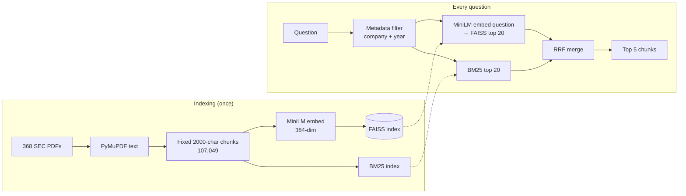
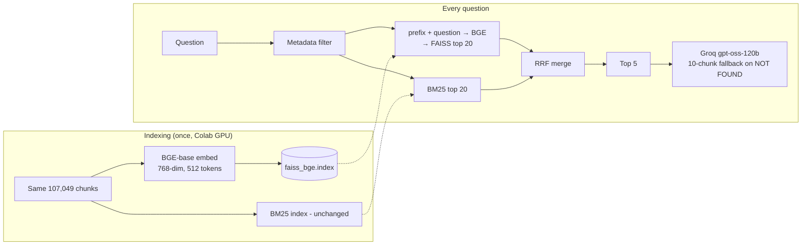
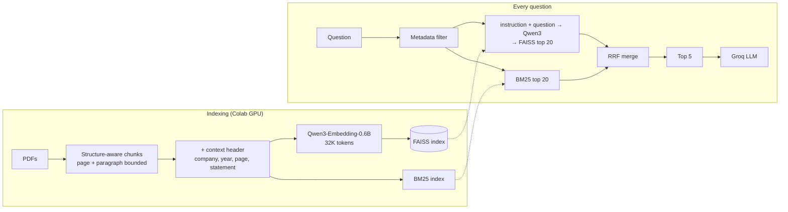

# Experiment Log: Retrieval & Embedding Evolution

A running record of what we tried, what it measured, and what we learned.
**Update this file after every experiment** — append a new version section and
update the comparison table. Numbers here are measured, never estimated, unless
marked *(expected)*.

| Version | Embedding model | Status | Headline result |
|---|---|---|---|
| [V1](#v1--baseline-all-minilm-l6-v2) | `all-MiniLM-L6-v2` | Done | Baseline. 47% answer-in-top-5 (tune set) |
| [V2](#v2--bge-base-en-v15) | `BAAI/bge-base-en-v1.5` | Done, **current default** | 53% answer-in-top-5 (tune set); +3 questions, not significant |
| [V3](#v3--qwen3-embedding-06b-planned) | `Qwen/Qwen3-Embedding-0.6B` + better chunks | **In progress** | Model alone: 61% top-5 on all 71 (BGE 59%); not significant. Chunking next |

---

## How we measure (read this first)

All comparisons use the same rules, so versions are comparable:

- **Question split** (fixed, seed 42, stratified by question type)
  - **71 "no-LLM" questions** — the expected answer is literally written in the filing.
    Split into **43 tune** (used to compare methods) and **28 holdout** (touched only
    for the final number, to avoid overfitting).
  - **79 "LLM" questions** — the answer must be calculated or synthesised.
- **Retrieval metric — "answer in top-k"**: a retrieved chunk is from the correct
  filing **and** contains the expected answer. Reported at top 5 (what the LLM sees)
  and top 10/20.
- **Strict answer matching** (fixed in V2, see [Metric bug](#the-metric-bug-found-during-v2)):
  years are not counted as answer values; unit scaling only applies when the answer
  states a unit.
- **Significance**: paired McNemar test per question. With 43 questions, gains under
  ~5 questions are usually noise (p > 0.05).

---

## V1 — Baseline: `all-MiniLM-L6-v2`

### Technology
| Stage | Choice | Details |
|---|---|---|
| PDF parsing | PyMuPDF (`fitz`) | Plain text per page, 368 filings |
| Chunking | Fixed-size sliding window | 2,000 chars, 300 overlap → **107,049 chunks** |
| Embedding | `sentence-transformers/all-MiniLM-L6-v2` | 22M params, 384-dim, **256-token limit** |
| Vector index | FAISS `IndexFlatIP` | Exact cosine search |
| Keyword search | BM25 (`bm25s`) | English stopwords + Snowball stemmer |
| Fusion | Reciprocal Rank Fusion | k = 60, top 20 from each search |
| Metadata filter | Rule-based (company + fiscal year from question text) | Restricts search to ~3 filings on average |
| Reranker | Cross-encoder `ms-marco-MiniLM-L-6-v2` | Measured, **disabled** (see below) |

### Workflow

### Results
| Measurement | Result |
|---|---|
| Metadata filter impact (old metric) | Wrong-document retrieval 61% → 18% — the biggest single gain so far |
| Answer in top 5 (43 tune, strict) | **20/43 (47%)** |
| Answer in top 10 / top 20 | 29/43 (67%) / 34/43 (79%) |
| Cross-encoder reranker (old metric) | +2.6pp but 60× slower → disabled |

### Flaws found
1. **Silent truncation** — MiniLM reads 256 tokens; chunks are ~450–500 tokens, so roughly
   the back half of every chunk never reached its vector.
2. **Weak general-purpose model** — small, older, not trained for question→passage retrieval.
3. **Chunks have no context** — a balance-sheet chunk doesn't say which company, year or
   statement it is.
4. **Tables cut mid-way** — year headers and numbers can land in different chunks.

---

## V2 — `BAAI/bge-base-en-v1.5`

### What changed and why
| | V1 | V2 |
|---|---|---|
| Model | all-MiniLM-L6-v2 | **bge-base-en-v1.5** |
| Parameters | 22M | 110M |
| Dimensions | 384 | 768 |
| Max input | 256 tokens | **512 tokens** (fixes most truncation) |
| Training | General sentence similarity | **Trained for question → passage retrieval** |
| Query handling | Plain | Query prefix `"Represent this sentence for searching relevant passages: "` |

Everything else (chunks, BM25, filter, RRF) unchanged, so the difference is the model alone.

**Embedding cost:** CPU ran at ~2 chunks/s (≈13+ hours for 107K chunks), so the index was
built on a **Google Colab T4 GPU** in ~20 minutes
([`tools/colab_embed_bge.ipynb`](../../tools/colab_embed_bge.ipynb) →
[`tools/build_bge_index.py`](../../tools/build_bge_index.py)) → `faiss_bge.index` (314 MB).

### Workflow

### Results vs V1
| Measurement (strict metric) | V1 MiniLM | V2 BGE | Change |
|---|---|---|---|
| Answer in top 5 — 43 tune | 20/43 (47%) | **23/43 (53%)** | +3, p = 0.45 (not significant) |
| Answer in top 10 — 43 tune | 29/43 (67%) | 27/43 (63%) | −2 |
| Answer in top 5 — earlier 80-question set | 40/80 | 45/80 | +5, p = 0.27 (not significant) |
| Answer in top 5 / top 10 — all 71 no-LLM | — | 42/71 (59%) / 48/71 (68%) | — |
| Query time | ~0.03 s | ~0.06 s | still fast |

**Verdict:** BGE is directionally better and stays the default, but a 5× bigger model gave a
small, statistically unproven gain. **The embedding model was not the main bottleneck.**

### The metric bug (found during V2)
The first BGE comparison reported **74.2% vs 63.4% (p = 0.021)**. That was wrong. The old
matcher counted:
- years in the answer (`"in FY 2022"`) as the value to find — any chunk mentioning 2022 passed (22 false successes);
- `COVID-19` as the number −19;
- unit scaling on ratios — `0.83` matched `833,033`.

Fixed with strict matching. "No-LLM" questions shrank from 93 → **71**; true scores are the ones above.

### End-to-end with the LLM (V2 retrieval + Groq `openai/gpt-oss-120b`)
79 LLM questions, top 5 chunks, retry with 10 chunks on NOT FOUND:

| Outcome | Count |
|---|---|
| Correct | **35 (44%)** + 2 partly correct |
| Wrong | 10 (13%) |
| NOT FOUND (refused) | **30 (38%)** |
| Error (request > 8K tokens) | 2 |
| **Correct when the LLM answered** | **35/47 = 74%** |
| 10-chunk fallback | 33 retried → 9 answered → 5 correct |

### Other experiments during V2
| Experiment | Result | Decision |
|---|---|---|
| **Cross-encoder rerankers** (top 40 → rerank → top 5), 43 tune | MiniLM-CE: 26/43 (+3, p=0.51, 4.7 s/q) bge-reranker-base: 27/43 (+4, p=0.29, 22 s/q) mxbai / bge-reranker-v2-m3: not completed (too slow on CPU) | Small, not significant, too slow on CPU — revisit with GPU after V3 |
| **Vector database** — is FAISS limiting us? | FAISS = brute-force exact on 40/40 queries. Time: BGE query embed 77 ms (83%), BM25 15 ms, **FAISS 0.8 ms (1%)** | **No change needed.** Another vector DB cannot improve accuracy |
| **Where do missed answers rank?** (all 150) | see below | Led to V3 |

### Flaws found — where the right chunk actually ranks
| Rank of answer chunk / evidence page | No-LLM (71) | LLM (79) |
|---|---|---|
| 1–5 (LLM sees it) | 39 (55%) | 31 (39%) |
| 6–20 | 14 (20%) | 14 (18%) |
| 21–50 | 9 (13%) | 8 (10%) |
| 51–200 | 4 (6%) | **21 (27%)** |
| Not in top 200 | 5 (7%) | 5 (6%) |

Of the 80 misses: **35%** are ranked 6–20 (a reranker can fix), **44%** are ranked 51+ or
missing (only better retrieval can fix). Root causes:
1. **Chunks have no identity** — no company/year/statement label, so "balance sheet FY2018"
   has nothing to match against.
2. **Tables split from their year headers** by the fixed 2,000-char cut.
3. **Some chunks still exceed 512 tokens** (e.g. 635 seen) — the tail is truncated.
4. **LLM questions need 2–3 statements** (e.g. inventory + cost of sales); questions name the
   metric, not the line items.
5. Smaller issues: a filter bug (`"VaR"` matched Activision instead of JPM), 2 questions name no company.

---

## V3 — `Qwen3-Embedding-0.6B` (planned)

### Why this model
| | V2 BGE-base | V3 Qwen3-Embedding-0.6B |
|---|---|---|
| Parameters | 110M | 600M |
| Max input | 512 tokens | **32K tokens** — no truncation of any chunk or full page |
| Query handling | Fixed prefix | **Task instruction**, e.g. *"Given a financial question, retrieve the filing passage that answers it"* |
| Standing | Strong 2023 model | Among the top open models on MTEB retrieval at its size |
| Runs on | Colab T4 | Colab T4 |

Alternatives considered: `bge-m3` (8K, dense+sparse), `gte-large-en-v1.5`,
`voyage-finance-2` (finance-specific, paid API), Qwen3-Embedding-4B/8B (too heavy for a free GPU).
"Best" is benchmark-dependent; Qwen3-0.6B is the strongest *practical* choice for our hardware.

### Plan — test model and chunking together
V2 showed a model swap alone gives a small gain, so V3 tests **model × chunking** in one Colab
run on the 63 filings the tune questions use:

| | Original chunks | + Context header | Structure-aware chunks |
|---|---|---|---|
| **BGE-base (V2)** | 22/42 ✅ measured | *to test* | *to test* |
| **Qwen3-Embedding-0.6B** | *to test* | *to test* | *to test* |

- **Context header**: each chunk prefixed with `[COMPANY 10K FY2018 | page 57 | Consolidated Balance Sheet]`.
- **Structure-aware chunks**: never cross a page, split at paragraph breaks, ~1,400 chars, same header.
  (Table→Markdown conversion was tried and dropped — PyMuPDF fragmented tables and split words.)

### Workflow (planned)

### Success criteria
- Beat V2's **23/43** answer-in-top-5 on the tune set with p < 0.05, then confirm on the 28 holdout.
- Reduce LLM NOT FOUND answers below the current **30/79**.

### Results — step 1: Qwen3 on the original chunks (model alone)
Embedded on a Colab T4 ([`tools/colab_embed_qwen.py`](../../tools/colab_embed_qwen.py)) →
`qwen_vectors.npy` → [`source/INGESTION/embedder3.py`](../../source/INGESTION/embedder3.py) →
`faiss_qwen.index` (418 MB). Verified: local CPU embeddings of sampled chunks match the
Colab vectors (cosine ≈ 1.00, rows aligned). Selected with `Retriever(embedding="qwen")`.

Answer in top-k, 71 no-LLM questions, same pipeline (filter + dense + BM25 + RRF):

| Model | Tune 43 @5 | Holdout 28 @5 | **All 71 @5** | All 71 @10 | All 71 @20 | Query time |
|---|---|---|---|---|---|---|
| MiniLM (V1) | 20 (47%) | 15 (54%) | 35 (49%) | 48 (68%) | 56 (79%) | 0.21 s |
| BGE-base (V2) | 23 (53%) | 19 (68%) | 42 (59%) | 48 (68%) | 55 (77%) | 0.24 s |
| **Qwen3-0.6B (V3)** | **24 (56%)** | 19 (68%) | **43 (61%)** | **51 (72%)** | **58 (82%)** | 1.78 s (CPU) |

Significance (paired McNemar, all 71):
- Qwen vs BGE: @5 +5/−4 (p = 1.0), @10 +5/−2 (p = 0.45) — **not significant**.
- Qwen vs MiniLM: @5 +10/−2 (**p = 0.039**) — the only significant model gain so far, but it
  took two model upgrades to get there.

**Verdict:** Qwen3 is the best of the three by a small margin (mostly at top 10/20), and
~7× slower per query on CPU. As with V2, **the embedding model is not the bottleneck** —
three models spanning 22M → 600M parameters land within 8 questions of each other at top 5.
This supports testing chunking next (step 2 of V3).

### Results — step 2: chunking (context header / structure-aware)
*To be filled in.*

---

## Next ideas (after V3)
- Reranker on GPU (or hosted API) over the top 40 — targets the 35% of misses ranked 6–20.
- Query rewriting for LLM questions: "inventory turnover" → separate searches for inventories (balance sheet) and cost of sales (income statement).
- Fix the `VaR` → Activision filter bug.
- Replace the keyword grader with an LLM judge for free-text answers.
